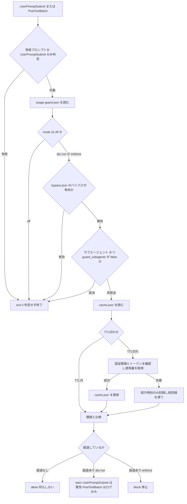
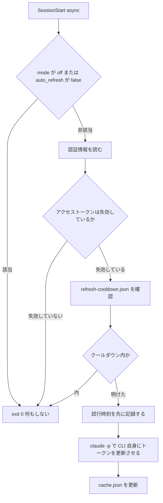

# usage-guard

Claude のサブスク枠（5時間枠・週次枠）の消費率を監視し、閾値を超えたら**次のモデル呼び出し前に** Claude を停止するプラグインです。無人の自動実行（CI・スケジュール実行など）が気づかないうちに使用量クレジットを消費し尽くすのを防ぎます。

これは**保証ではなく自衛用の速度制限**です。フックはモデル呼び出しそのものをラップしないため、進行中のターンを途中で止めることはできません。「1トークンも超えない」ことは原理的に不可能で、「超過を数リクエストに抑える」精度のガードです。

## しくみ

1. 使用量は OAuth 使用量エンドポイント（`api.anthropic.com/api/oauth/usage`）から取得し、`cache.json` にキャッシュする（`fetch_ttl_sec` 以内なら再取得しない）
2. `UserPromptSubmit` と `PostToolBatch` の両フックが、キャッシュされた消費率を閾値と比較して判定する
3. 超過していれば `mode: "enforce"` では停止、`mode: "dry-run"` では警告のみ
4. アクセストークンの失効・キャッシュ更新は `SessionStart`（`async: true`）が別経路で担い、判定フックの応答を遅らせない

判定に使うトークンは読み取り専用で扱う（このプラグインは認証情報を一切書き込まない）。トークンのローテーションと Keychain / `~/.claude/.credentials.json` への書き込みは Claude Code CLI 自身が所有しており、別プロセスから書くと CLI 側の状態と食い違って認証が壊れるため。

### 同期の判定経路



### 非同期のトークン更新経路



## イベントの選び方

| イベント | 発火タイミング | 採用理由 |
| --- | --- | --- |
| `PostToolBatch` | バッチ内の全ツール解決後、次のモデル呼び出し前に1回 | 追加のモデル呼び出しを最も確実に抑えられる位置。**`matcher` 非対応**（全ツールバッチ共通） |
| `UserPromptSubmit` | ユーザーがプロンプトを送信したとき | ツールを使わないターンが連続すると `PostToolBatch` が発火しないため、これと併用して判定漏れを防ぐ |

停止方法もイベントごとに異なる。

| イベント | 停止方法 | 補足 |
| --- | --- | --- |
| `UserPromptSubmit` | `decision: "block"` + `reason` | dry-run では代わりに `systemMessage` を返し、プロンプトは通す |
| `PostToolBatch` | `continue: false` + `stopReason` | `stopReason` はユーザーに表示される。dry-run では何も出力しない（毎バッチ通知はスパムになるため） |

## 設定ファイル

`~/.claude/usage-guard.json`（`CLAUDE_CONFIG_DIR` 設定時はその配下）を置くと個別キーを上書きできます。ファイルが無くても既定値で動作し、**既定は `mode: "dry-run"` なので何も停止しません。**

これはユーザーが手で編集する唯一のファイルなので、パスが推測できて消えない場所に置いています（機械が管理するキャッシュ等は別の場所です。[ファイル](#ファイル)を参照）。実パスは `/usage-guard:usage-guard-status` の出力と、停止時のメッセージにも表示されます。

| キー | 既定値 | 説明 |
| --- | --- | --- |
| `mode` | `"dry-run"` | `"off"`（無効） / `"dry-run"`（警告のみ） / `"enforce"`（実際に停止）。不正な値は `"dry-run"` にフォールバックする |
| `thresholds.five_hour` | `90` | 5時間枠の停止閾値（%）。`null` にするとそのウィンドウを無視する |
| `thresholds.seven_day` | `95` | 週次枠の停止閾値（%）。同上 |
| `guard_subagents` | `true` | サブエージェント（`agent_type` あり）にもガードを適用するか |
| `fetch_ttl_sec` | `60` | 使用量 API のキャッシュ有効期間（秒） |
| `version_ttl_sec` | `86400` | User-Agent 用 CLI バージョンのキャッシュ有効期間（秒） |
| `auto_refresh` | `true` | アクセストークン失効時に `SessionStart` で自動リフレッシュを試みるか |
| `refresh_cooldown_sec` | `600` | リフレッシュ試行の最小間隔（秒）。失敗連打を防ぐ |

閾値の比較は `utilization >= threshold`（等しい場合も超過扱い）。数値は 0〜100 にクランプされ、未知キーは破棄される。

閾値の値については、**キーが無い場合と、キーはあるが値が数値でない場合で挙動が異なります**。

| 書き方 | 挙動 |
|---|---|
| `"thresholds": {}`（キー自体が無い） | 既定値（`five_hour` 90 / `seven_day` 95）で判定する |
| `"five_hour": 90` | その値で判定する |
| `"five_hour": null` | **そのウィンドウを監視対象外にする**（意図的な無効化） |
| `"five_hour": "90"`（文字列）など数値以外 | **そのウィンドウを監視対象外にする**（既定値には戻らない） |

つまり `"90"` のように誤ってクォートで囲むと、そのウィンドウのガードは既定値で動くのではなく**黙って無効化されます**。設定を変更したら `/usage-guard:usage-guard-status` で「閾値 N%」と表示されること（「監視対象外」になっていないこと）を確認してください。

閾値を 100 ではなく 90 / 95 にしているのは、進行中のターンは止められず、判定に使う消費率も**最後に取得した時点の値**でしかないためです。閾値を 100 にすると、実際の消費率が 100% に達した時点ではすでに超過が確定しており、必ず超過してから止まることになります。

### 設定例（`~/.claude/usage-guard.json`）

```json
{
  "mode": "enforce",
  "thresholds": { "five_hour": 90, "seven_day": 95 },
  "guard_subagents": true
}
```

## ファイル

**ユーザーが編集する設定**と、**機械が管理する状態**を置き場所で分けています。

| 種別 | 置き場所 | 理由 |
| --- | --- | --- |
| 設定（`usage-guard.json`） | `~/.claude/`（`CLAUDE_CONFIG_DIR` 設定時はその配下） | パスが推測でき、プラグインをアンインストールしても消えない |
| 状態（下記4ファイル） | `${CLAUDE_PLUGIN_DATA}` | プラグイン専用の永続領域。消えても再生成される。フックとスキルの双方に同じ値が渡るため両者が同じ場所を参照する |

`CLAUDE_PLUGIN_DATA` が渡らない環境で直接スクリプトを叩いた場合、状態ファイルは
`~/.claude/usage-guard/`（`CLAUDE_CONFIG_DIR` 設定時はその配下）にフォールバックします。

| ファイル | 役割 |
| --- | --- |
| `usage-guard.json` | 設定（上記）。**設定ディレクトリ直下**。フック実行ごとに読む |
| `cache.json` | 使用量のキャッシュ（`fetched_at` / `windows.five_hour` / `windows.seven_day` / `cc_version` など） |
| `bypass.json` | バイパス（一時解除）の状態（`until` / `set_at` / `note`）。`until` が現在時刻より未来の間だけ有効 |
| `usage.log` | 監査用 JSONL ログ。`block` は必ず記録、`warn` は `PostToolBatch` のときだけ記録する（`UserPromptSubmit` の warn はユーザーに `systemMessage` として見えるため二重記録しない） |
| `refresh-cooldown.json` | トークンリフレッシュの最終試行時刻（`last_attempt_at`）。クールダウン判定に使う。**試行の成否に関わらず、試行前に記録する**（恒久的な認証失敗があっても、セッションを開くたびに60秒かかる子プロセスを起動し続けないため） |

## スキル

| スキル | 用途 |
| --- | --- |
| `usage-guard-status` | 現在の状態（mode、各枠の消費率と閾値、リセット時刻、バイパス状況、判定）を表示する |
| `usage-guard-bypass` | 閾値ブロックを一時解除する。引数 `30m`（分） / `2h`（時間） / `90`（分として解釈） / `reset`（5時間枠のリセットまで） / `off`（解除）、省略時は30分 |

両スキルの名前が `usage-guard-` で始まっているのは、免除判定と結び付いているためです。`UserPromptSubmit` フックはプロンプトが `/usage-guard` に前方一致すると、config・cache を読む前に判定そのものを免除します。これが無いと、enforce モードで閾値超過中は全プロンプトがブロックされるため、「`/usage-guard:usage-guard-bypass 30m` で一時解除する」というバイパス操作自体がブロックされ、ユーザーは設定ファイルを手で編集する以外に復帰手段を失います（デッドロック）。スキル名を短くすると免除の前方一致が効かなくなるため、この命名は必須です。

## 環境変数

| 変数 | 既定 | 説明 |
| --- | --- | --- |
| `CLAUDE_PLUGIN_DATA` | Claude Code が設定 | プラグイン専用の永続データディレクトリ。状態ファイル（cache / bypass / log / refresh-cooldown）の置き場所。フックとスキルの両方に渡るため双方が同じ場所を見る |
| `CLAUDE_CONFIG_DIR` | 未設定（`~/.claude`） | Claude Code の設定ディレクトリ。`usage-guard.json` と `.credentials.json` の探索先がこれに追従する |
| `USAGE_GUARD_DEBUG` | 未設定（ログ無効） | 真の値を設定するとステップログを出力する |
| `USAGE_GUARD_DEBUG_FILE` | OS の temp ディレクトリ | デバッグログの出力先。既定は `<tmpdir>/usage-guard-debug.log` |

## 前提条件

- `node`
- 使用量エンドポイントが応答するアカウント（Pro / Max / Team シート）
- `claude` CLI が PATH から実行できること（User-Agent 用バージョン検出とトークンリフレッシュに使用。実行できなくても両方フォールバックがあり、フックは動作を続ける）
- macOS では認証情報の読み取りに `security find-generic-password`（サービス名 `Claude Code-credentials`）を使う。失敗時、または非 macOS 環境では `.credentials.json` にフォールバックする（`~/.claude/`、`CLAUDE_CONFIG_DIR` 設定時はその配下）

## 使い方（段階的な導入）

### Phase 1: 観測（dry-run）

`mode: "dry-run"` のまま、閾値を現在の消費率より低く設定して超過経路を確認します。`UserPromptSubmit` では警告が `systemMessage` として画面に出ますが、`PostToolBatch` では `usage.log` に記録されるだけで通知は出しません（毎バッチ通知はスパムになるため）。

### Phase 2: 実効化（enforce）

`mode: "enforce"` に切り替えます。**切り替え前に必ずデッドロック脱出訓練を行ってください。** 閾値を 1% にして必ずブロックさせ、`/usage-guard:usage-guard-bypass 10m` が通ることを確認してから、実運用の閾値に戻します。

## トレードオフ・既知の制限

- **保証ではなく速度制限。** 進行中のターンは止められないため「1トークンも超えない」は原理的に不可能で、「超過を数リクエストに抑える」精度にとどまる。
- **非公式 API に依存。** `api.anthropic.com/api/oauth/usage` は文書化されていないため、変更・廃止・429 の可能性がある。失敗時は fail-open（キャッシュの既存値を使い、それも無ければ許可）。
- **fail-open の設計。** 使用量が取得できないことを理由にユーザーの作業を止めない。誤ってブロックし続けて作業不能になるより、守れないときは通す方を選ぶ。
- **OAuth トークンの失効。** トークンは数時間で失効し、CLI が API と通信したときのみ更新される。`SessionStart` の非同期フックが `claude -p`（`claude-haiku-4-5-20251001`, `--max-turns 1`, クールダウン付き）で更新を試みる。**これはわずかに推論クォータを消費する**（`auto_refresh: false` で無効化可能）。
- **Claude Desktop での有効性は未検証。** Desktop ホストが Keychain のトークンを更新しない場合、再認証フックが機能するかどうかがガードの有効性を決める。
- **`resets_at` を過ぎるまで古い値を保持する。** 消費率はリセットまで単調増加なので、古い高い値でも「止めるべき」判定として有効。財布に安全な方向に働く。
- **サブエージェントを止めると作業が失われる。** `guard_subagents: false` で無効化できる。
- **免除は `/usage-guard` の前方一致。** `/usage-guardian` のような無関係な名前も免除される（緩い側の誤りで財布への影響は限定的）。
- **最終脱出口。** どうしても操作できなくなったら `~/.claude/usage-guard.json` の `mode` を `"off"` に手で書き換える（Claude を介さないので必ず可能）。パスは停止メッセージにも表示され、`/usage-guard:usage-guard-status` は免除対象なので閾値超過中でも実行できる。
- **確実な上限は組織の Spend limits で担保する。** Team プランでは使用量クレジットの有効・無効は Owner / Primary Owner の管理下にあり、メンバー側の設定では止められない。Organization settings > Usage の「Spend limits by user」で月額上限を設定してもらうのが確実な手段。本プラグインは手元の速度制限にすぎない。

- **アンインストールで状態ファイルは消える。** `${CLAUDE_PLUGIN_DATA}` は既定でアンインストール時に削除される（`--keep-data` で保持可能）。ただし消えるのはキャッシュ等の再生成可能なファイルだけで、**設定（`usage-guard.json`）は設定ディレクトリ側にあるため残る**。

`hooks.json` はセッション起動時に読み込まれるため、プラグインをアップデートしても実行中のセッションには反映されません。反映するには Claude Code を再起動してください。ただし `usage-guard.json` / `cache.json` / `bypass.json` はフック実行ごとに読むため、これらの変更に再起動は不要です。

## 関連プラグイン

- [`permission-gate`](../permission-gate) — `claude -p` を1回呼んで自然言語ルールを判定する方式を採用している。usage-guard の `refresh.mjs` も同じ `claude -p`（`--setting-sources ""` + `--strict-mcp-config` で子プロセスのフック再発火を防ぐ）を使う。
- [`compact-handoff`](../compact-handoff) — 同じ `claude -p`（別プロセスの Claude）呼び出し方式を採用している。
